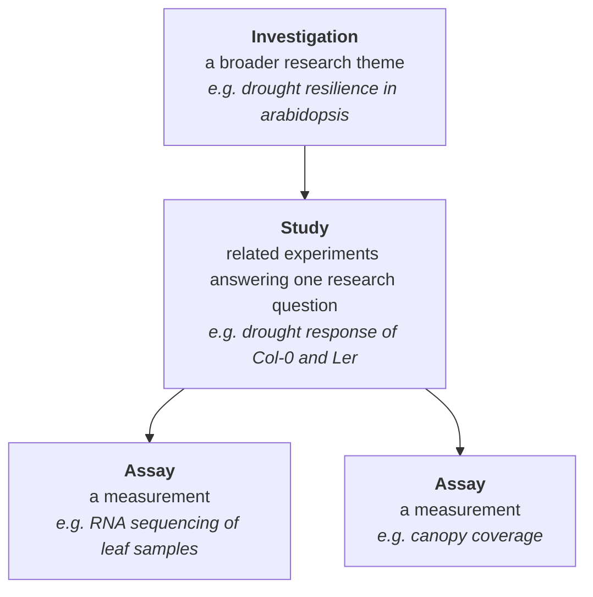
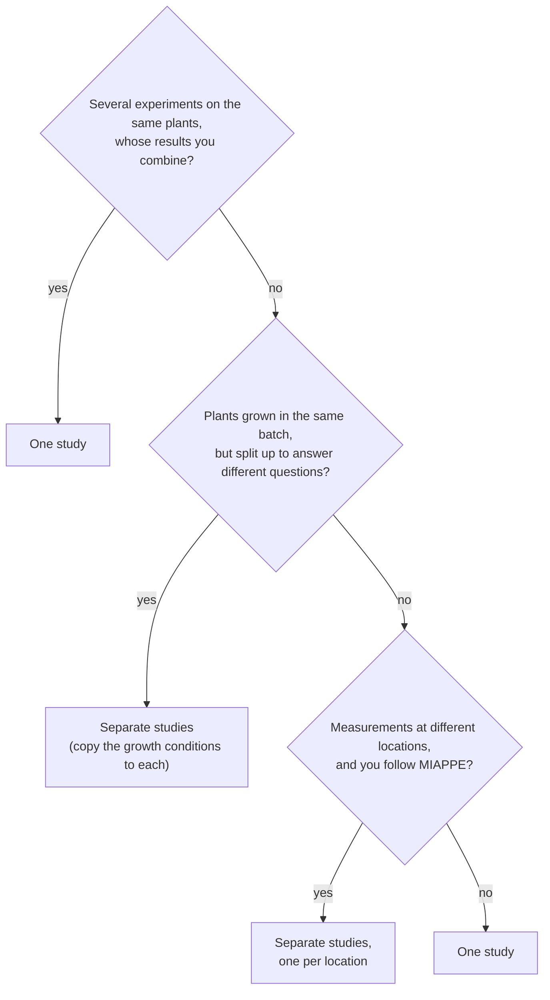

# Defining a Study

## The Investigation-Study-Assay (ISA) structure

CropXR organizes research data with the [ISA](https://isa-specs.readthedocs.io/en/latest/index.html) (Investigation-Study-Assay) structure, an established framework for describing experiments. The catalogue follows this structure, so every study you enter fits into it. It has three levels:

- An **investigation** contains one or more studies.
- A **study** contains the plants, samples and assays of a set of related experiments.
- An **assay** is a measurement performed on the samples or plants of the study.

As a researcher you are free to define investigations and studies as you need. The sections below give tips and constraints to help you. How assays are described is explained in the [Metadata Model](metadata-model.md).

## Investigation and study

| | Investigation | Study |
|---|---|---|
| **Size** | A PhD project, or the work of several researchers combined | Roughly one paper |
| **Answers** | A larger topic with several standalone subquestions | One research question, with a standalone set of relevant data |
| **Decided by** | Typically the PI, who has a plan for how the investigations are defined | You, the researcher. Multiple people can work together on a study |

## One study or several?

Use this to decide how to group your experiments:

- **Combine experiments on the same plants.** It is not possible to directly reference plants/samples in another study, so experiments whose results you need to combine belong in one study.
- **Split plants that answer different questions.** If plants are grown in the same batch but split up to answer different questions, it is usually best to make separate studies. You can simply copy the growth conditions to each study.
- **One location per study, if you follow MIAPPE.** While CropXR does not require this, MIAPPE assumes that a study is in a single location. If you wish to stay close to the MIAPPE format, separate measurements performed at different locations into different studies.

!!! example
    You grow two *Arabidopsis* varieties (Col-0 and Ler) under well-watered and drought conditions. You take root and leaf samples for RNA sequencing, and measure canopy coverage on the same plants. This is **one study**, because you will relate gene expression to the observed phenotype. See the [High-Level Example](../resilience-hub/seek/high-level-example.md) for how this study is entered in the catalogue.

## Naming your study

Choose a name that tells other researchers in the consortium what the study is about, without having to open it. A good study name:

- describes the research question or the main experiment, for example the treatment and the response that is measured
- includes the organism or crop
- avoids abbreviations and internal project codes that only your group knows

| ✅ Good | ❌ Avoid |
|---|---|
| Drought response of arabidopsis after hormonal treatment with PAMP | WP3 exp2 final |

The naming conventions for assays and other items in the catalogue can be found in the [Catalogue Reference](../resilience-hub/seek/reference.md#naming-conventions).

!!! note "No separate registration step"
    There is no separate registration form. All metadata goes into the [data catalogue](https://catalogue.cropresilience.org/), and that is where you register your investigation and study.
