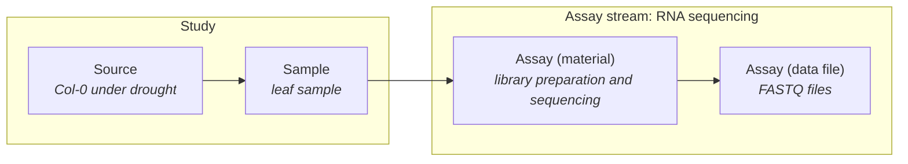
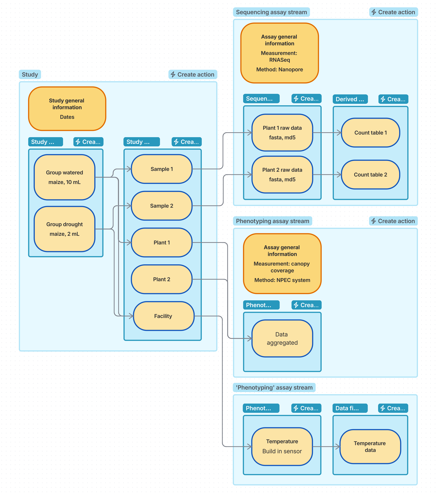

# Metadata Model

All research produced in the CropXR consortium is annotated with metadata following the CropXR standards. Annotating your data is your responsibility as a researcher; DataXR provides the tools and help.

!!! tip "The model is flexible"
    The model fits many types of studies, so you decide how to apply it to yours. If you are stuck, contact the [DataXR team](mailto:data@cropxr.org).

## Standards

The CropXR metadata model combines established standards for metadata on plant research:

| Study type | Standards |
|---|---|
| Phenotyping | [ISA](https://isa-specs.readthedocs.io/en/latest/index.html) + [MIAPPE](https://github.com/MIAPPE/MIAPPE) |
| Sequencing | [ISA](https://isa-specs.readthedocs.io/en/latest/index.html) + ENA for plants (ENA35) + ENA for crops (ENA37) + additional fields based on LettuceKnow experience. See the [ENA sample checklists](https://www.ebi.ac.uk/ena/browser/checklists). |

MIAPPE and ENA give a standardized way to describe the setup of a study, the experimental conditions, the types of measurements performed, and how the output data relates to them, down to sample level. This makes the data easier to find and reuse.

Because both standards describe the setup of a plant experiment, they overlap a lot. To keep the metadata uniform, and to be able to describe combined experiments, they have been combined into one unified model. In this model, you describe the plants and growth conditions at study level, and from there start multiple types of measurements.

The ISA format is widely used to represent research data, and is often used for MIAPPE data. The catalogue uses the ISA structure, somewhat adapted.

## How your experiment maps onto the catalogue



The **study** holds your plant material (sources) and what you took from it (samples). Each type of measurement gets its own **assay stream**, made of steps called **assays**: first the measurement itself, then the data files it produced.

!!! info "Two words that work differently in the catalogue"
    - **Assay:** every step under the study is called an assay, even when its input and output are both material (like an RNA extraction) or both data files.
    - **Sample:** every row in every table is called a "sample", even when it describes an assay or a data file.

### Assay and sample definition

In ISA, assays are performed on samples. An experiment is seen as a series of steps, called processes. Each process has an input, an output, and a protocol that describes how the output was made from the input. The input and output can each be material or data, and processes can be chained together. For example:

| Step | Process | Input | Output |
|---|---|---|---|
| 1 | Sample collection | Plant material | Sample |
| 2 | DNA extraction and library preparation | Sample | Sample |
| 3 | Sequencing | Sample | Data |
| 4 | Analysis | Data | Data |

In ISA, the study contains one process, from a material input (the study source) to a material output (the study sample). All other processes, however many are needed, are grouped under the assay, which starts with the study sample.



## What goes where

| Section | What it describes | Example |
|---|---|---|
| [Study extended metadata](#study-extended-metadata) | Information that is the same for the whole study | location, dates |
| [Study sources](#study-sources) | The plant material, growth conditions and treatment | Col-0 under drought |
| [Study samples](#study-samples) | Samples and observation units | a leaf sample, a plot |
| [Assay stream extended metadata](#phenotyping-assay-extended-metadata) | Information that is the same for every measurement in the stream | the measured trait and method |
| [Assay rows](#assay-rows) | One row per measurement | canopy coverage of one plot |
| [Derived data files](#derived-data-files) | Data processed from earlier output | count tables |

### Study extended metadata

Information that is the same for the whole study.

### Study sources

The study sources section describes the plant, the growth conditions and the treatment.

Besides the suggested standard parameters, you can include additional parameters. Use the MIAPPE lists for growth conditions and experimental factors for predictable descriptions. Not all conditions are equally relevant, and not all need to be included in the metadata.

Choose the granularity that is needed for your metadata. The sources specify the biological material as well as the growth conditions. At least each experimental block needs to be defined as a separate source. If you need to trace a sample back to an individual plant, define one source per plant.

### Study samples

An observation unit is any level on which a measurement or observation is done, such as a plant, a plot, a whole field or a greenhouse. A sample is a special level: a physical part of the plant collected for analysis. It contains some information about the sampling.

Both samples and observation units are listed under the study samples section, and they can be nested.

How you define them depends on the design of your study. Usually it is the unit for which an experiment produces a file. Think about the assays and the data files when defining the observation units.

### Phenotyping assay extended metadata

Each type of phenotyping measurement is represented by an assay stream. The observed variable describes the measurement: what was measured and how, including the instrument. It can describe any type of measurement, which is important because phenotyping does not rely on a limited set of experiments. It does require you to describe the measurement in the format.

As more people annotate their metadata, it will be valuable to create a CropXR internal reference that shows how others have described the same or similar experiments.

The assay stream extended metadata captures the information that is the same for each individual measurement.

### Assay rows

Each row describes a measurement on a sample or observation unit. Include any information that differs per measurement or is not captured in the assay extended metadata. Typically, include the data file location of the output of the measurement.

### General assay

When you do several types of measurements that each produce only a few outputs, it is easier to describe them without a separate assay stream for each. You can make a general assay that includes multiple measurement types.

This assay has no extended metadata at assay stream level. Each row describes the measurement: what was measured and how. In a next assay step, the data file is linked to the measurement.

### Derived data files

For derived data files, add a separate assay step. The input is an output file of the previous step, and you can describe the method used to derive the data.

## Practical

### Relevant columns

Not all fields are relevant to each study.

### Fixed or free fields

Some fields are free text, some require you to pick from a list (a controlled vocabulary), and some are free text with a list of suggestions to pick from.

## Entity-relationship diagrams

Not every diagram applies to every study. Jump to the ones you need:

- **[Containers and study-level metadata](#containers-and-study-level-metadata)**: properties of the whole study and assay stream. *All studies.*
- **[The source](#the-source-shared-by-both-streams)**: the plant, its growth conditions and treatment. *All studies.*
- **[Sequencing stream](#sequencing-stream)**: samples, sequencing assays and data files. *Sequencing studies.*
- **[Phenotyping stream](#phenotyping-stream)**: observation units, observations and data files. *Phenotyping studies.*
- **[Combined sample](#combined-sample)**: one sample template for studies that record more than one stream, used with the assays of each stream it records. *Combined studies.*
- **[What the model cannot express](#what-the-model-cannot-express)**: known limitations. *Worth reading before you start.*

The diagrams below show model 1.0, the last per-file state of the definitions from 260727 before templates were renamed by stream. Every box is a table in the catalogue, and every row of every table is a "sample" to SEEK. `PK` marks the column SEEK displays as the row's name; it must be unique within the table. `FK` marks the `Input` column, a list of rows from the table one level up. `cv` is a controlled vocabulary, `link` is a reference to a record registered elsewhere in the catalogue. Fields marked `REQ` are required; the rest are optional.

### Containers and study-level metadata

Whole-study and whole-assay properties do not sit in the tables. They sit on the Study and the assay stream as extended metadata, one type per stream. The phenotyping and combined study types embed nested records for location, experimental design and growth facility. The sequencing study type carries only the study id and the dates.

??? abstract "Show the diagram"

    ```mermaid
    erDiagram
        INVESTIGATION ||--o{ STUDY : contains
        STUDY ||--o{ ASSAY_STREAM : contains
        ASSAY_STREAM ||--|{ ASSAY : contains
        STUDY ||--o| STUDY_METADATA : "extended metadata"
        ASSAY_STREAM ||--o| ASSAY_METADATA : "extended metadata"
        STUDY_METADATA ||--o| LOCATION : links
        STUDY_METADATA ||--o| EXPERIMENTAL_DESIGN : links
        STUDY_METADATA ||--o| GROWTH_FACILITY : links
        STUDY ||--|| SOURCE_TABLE : "study source"
        STUDY ||--|{ SAMPLE_TABLE : "study sample"
        ASSAY ||--|| ASSAY_TABLE : "assay - material or assay - data file"

        STUDY_METADATA {
            string study_id PK "REQ"
            string study_start_date
            string study_end_date
            text cultural_practices
        }
        LOCATION {
            string experimental_site_name
            string latitude
            string longitude
            string altitude
            cv country
        }
        EXPERIMENTAL_DESIGN {
            text experimental_design_description
            string experimental_design_type
            string observation_unit_level_hierarchy
            text observation_unit_description
        }
        GROWTH_FACILITY {
            text growth_facility_description
            string growth_facility
        }
    ```

The study types are `CropXR phenotyping study`, `CropXR sequencing study` and `CropXR combined study`. The assay types are shown in the stream diagrams below.

### The source, shared by both streams

One source row is a genotype or seed batch together with the conditions it was grown under before treatment (`growth_*`) and during treatment (`treatment_*`). Those conditions apply to every sample and file derived from the row, so anything that varies per plant belongs on the sample instead. A source can hold one treatment.

??? abstract "Show the diagram"

    ```mermaid
    erDiagram
        SOURCE {
            string Source_Name PK "REQ"
            cv country
            int taxon_id
            string species_name
            string genotype
            string genebank
            string ecotype
            string cultivar
            string latitude
            string longitude
            string altitude
            string sex
            string seed_batch_id
            string growth_conditions
            string growth_facility_description
            string growth_facility
            cv growth_medium
            string growth_light_regimen
            real growth_temperature_day
            real growth_temperature_night
            real growth_light_intensity
            real growth_light_rfr_ratio
            cv experimental_group
            text treatment
            string treatment_ontology
            string treatment_growth_medium
            string treatment_light_regimen
            real treatment_temperature_day
            real treatment_temperature_night
            real treatment_light_intensity
            real treatment_light_rfr_ratio
            string treatment_time_duration
            string treatment_time_of_day
            string treatment_chemical
            string treatment_chemical_cas_id
        }
    ```

### Sequencing stream

The library fields follow ENA and sit on the assay stream's extended metadata, because they hold for every sample sequenced in that assay. The assay row therefore carries little more than an id and the library construction protocol. It is followed by `CropXR sequencing data file`, one row per file.

??? abstract "Show the diagram"

    ```mermaid
    erDiagram
        SOURCE }|--o{ SAMPLE : Input
        SAMPLE }|--o{ SEQUENCING_ASSAY_CONDENSED : Input
        SEQUENCING_ASSAY_CONDENSED }|--o{ SEQUENCING_DATA_FILE : Input
        SAMPLE }|--o{ SEQUENCING_ASSAY_AND_DATA_FILE : Input
        SEQUENCING_DATA_FILE }o--|| DATA_FILE_RECORD : file_location
        SEQUENCING_ASSAY_AND_DATA_FILE }o--|| DATA_FILE_RECORD : file_location
        SEQUENCING_ASSAY_METADATA ||--o{ SEQUENCING_ASSAY_CONDENSED : "assay stream"

        SAMPLE {
            link Input FK "REQ"
            string subject_id PK "REQ"
            string title "REQ"
            string description
            string protocol "REQ"
            date collection_date
            date biochemical_extraction_date
            date sequencing_submission_date
            string plant_structure_ontology
            string plant_structure
            string age
            string plant_developmental_stage_text
            string plant_developmental_stage_ontology
            string spatial_distribution
            string external_id
            text remarks
        }
        SEQUENCING_ASSAY_CONDENSED {
            link Input FK "REQ"
            string experiment_id PK "REQ"
            string library_construction_protocol "REQ"
            string design_description
            string external_id
        }
        SEQUENCING_DATA_FILE {
            link Input FK "REQ"
            string file_name PK "REQ"
            link file_location "REQ"
            text file_description
            string protocol "REQ"
            cv file_type
            string md5_checksum
            string external_id
            cv raw_or_derived
        }
        SEQUENCING_ASSAY_AND_DATA_FILE {
            link Input FK "REQ"
            string design_description
            string file_name PK "REQ"
            link file_location "REQ"
            text file_description
            string protocol "REQ"
            cv file_type
            string md5_checksum
            string external_id
            cv raw_or_derived
        }
        SEQUENCING_ASSAY_METADATA {
            string study_external_id
            cv study_type
            string library_construction_protocol
            string design_description
            cv library_source
            cv library_strategy
            cv library_selection
            cv library_layout
            string insert_size
            cv platform
            cv instrument_model
        }
        DATA_FILE_RECORD {
            string title
            string remote_url
        }
    ```

### Phenotyping stream

The study sample is an observation unit: the plant, plot, greenhouse or other level on which a measurement is made. Units can nest through `parent_subject_id`, which is a name and not a checked link. The observed variable, method, instrument and scale can be described once on the assay stream's extended metadata, or per row in `CropXR phenotyping assay` when they differ between rows. Files are recorded in `CropXR phenotyping data file`.

??? abstract "Show the diagram"

    ```mermaid
    erDiagram
        SOURCE }|--o{ OBSERVATION_UNIT : Input
        OBSERVATION_UNIT }|--o{ OBSERVATION : Input
        OBSERVATION }|--o{ DATA_FILE : Input
        OBSERVATION_UNIT }|--o{ CONDENSED_OBSERVATION_ASSAY_WITH_DATA_FILE : Input
        DATA_FILE }o--|| DATA_FILE_RECORD : file_location
        CONDENSED_OBSERVATION_ASSAY_WITH_DATA_FILE }o--|| DATA_FILE_RECORD : file_location
        PHENOTYPING_ASSAY_METADATA ||--o{ OBSERVATION : "assay stream"

        OBSERVATION_UNIT {
            link Input FK "REQ"
            string subject_id PK "REQ"
            string title "REQ"
            string description
            string type "REQ, the protocol"
            string plant_structure_ontology
            string plant_structure
            string age
            string plant_developmental_stage_text
            string plant_developmental_stage_ontology
            string observation_unit_type
            string parent_subject_id
            string spatial_distribution
            text remarks
        }
        OBSERVATION {
            link Input FK "REQ"
            string experiment_id PK "REQ"
            string variable_name
            string variable_accession_number
            string trait
            string method "REQ, the protocol"
            string method_accession_number
            string method_description
            string reference_method
            string instrument
            string instrument_metadata
            string scale
            string scale_accession_number
            string time_scale
        }
        DATA_FILE {
            link Input FK "REQ"
            string file_name PK "REQ"
            link file_location "REQ"
            text file_description
            string protocol "REQ"
            string file_type
            string md5_checksum
            cv raw_or_derived
        }
        CONDENSED_OBSERVATION_ASSAY_WITH_DATA_FILE {
            link Input FK "REQ"
            string protocol "REQ"
            string file_name PK "REQ"
            link file_location "REQ"
            text file_description
            string file_type
            string md5_checksum
            cv raw_or_derived
        }
        PHENOTYPING_ASSAY_METADATA {
            string variable_name
            string variable_accession_number
            string trait
            string method
            string method_accession_number
            string method_description
            string reference_method
            string instrument
            link instrument_metadata
            string scale
            string scale_accession_number
            string time_scale
        }
        DATA_FILE_RECORD {
            string title
            string remote_url
        }
    ```

### Combined sample

A study that records more than one stream can use `CropXR combined sample` instead of a stream's own sample template. It carries the union of the sequencing sample, phenotyping observation unit and metabolomics sample fields plus a `subject_type` that says which one a row is.

??? abstract "Show the diagram"

    ```mermaid
    erDiagram
        SOURCE }|--o{ SAMPLE_OR_OBSERVATION_UNIT : Input
        SAMPLE_OR_OBSERVATION_UNIT }|--o{ SEQUENCING_ASSAY_CONDENSED : Input
        SAMPLE_OR_OBSERVATION_UNIT }|--o{ OBSERVATION : Input

        SAMPLE_OR_OBSERVATION_UNIT {
            link Input FK "REQ"
            string subject_id PK "REQ"
            cv subject_type "REQ"
            string title "REQ"
            string description
            string protocol "REQ"
            date collection_date
            string biochemical_extraction_date
            date sequencing_submission_date
            string plant_structure_ontology
            string plant_structure
            string age
            string plant_developmental_stage_text
            string plant_developmental_stage_ontology
            string observation_unit_type
            string parent_subject_id
            string spatial_distribution
            string external_id
            text remarks
        }
    ```

### What the model cannot express

- A link between rows of different studies.
- A derived file whose inputs come from two assay streams.
- More than one treatment on a source.
- An observation unit hierarchy that the catalogue checks.
- Metabolomics measurements.

Field descriptions and vocabulary terms are listed in the [metadata definitions repository](https://gitlab.ewi.tudelft.nl/reit/dataXR/seek-metadata-definitions).


## Outlook
In the future the catalogue will be extended to cover metabolomics data.

The catalogue can be improved with small suggestions based on researcher feedback.

There will be a way to export the metadata into an ENA format for easy submission. There will be an importer that can import published ENA metadata into the format of the catalogue. 
