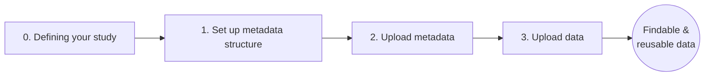

# Getting Started

This page walks you through what you will do as a researcher, in the order that you will usually do it.

## Why upload to the Resilience Hub?

- **Findable:** researchers across the consortium can find your study in the catalogue.
- **Reusable:** your data comes with the details of your experiment, so others can understand and reuse it.
- **In your control:** you decide who can see and download your data.

## Getting your research data on the Resilience Hub

## What do you want to do?

-   :material-book-open-variant: **Know the metadata models**

    ---

    Understand how studies, samples, assays and data files are described before you start.

    [:octicons-arrow-right-24: Metadata models](../concepts/metadata-model.md)

-   :material-clipboard-text-outline: **Define a study**

    ---

    Decide what your study contains and how to name it.

    [:octicons-arrow-right-24: Define a study](../concepts/defining-a-study/)

-   :material-table-arrow-up: **Upload metadata**

    ---

    Describe your study, samples and assays in the catalogue.

    [:octicons-arrow-right-24: Upload metadata](../resilience-hub/seek/full-guide.md)

-   :material-cloud-upload-outline: **Upload data**

    ---

    Send your data files with the command line tool.

    [:octicons-arrow-right-24: Upload data](../resilience-hub/cli-tool/index.md)

## More help

| If you… | Go to |
|---|---|
| are new to CropXR | [Concepts](../concepts/index.md) |
| need a step-by-step walkthrough | [Guides](../guides/index.md) |
| are looking for older data | [Research Drive](../research-drive/index.md) |
| are sharing sensitive data | [Policies](../policies/index.md) |
| came across an unfamiliar term | [Glossary](glossary.md) |
| are stuck | email [data@cropxr.org](mailto:data@cropxr.org) |