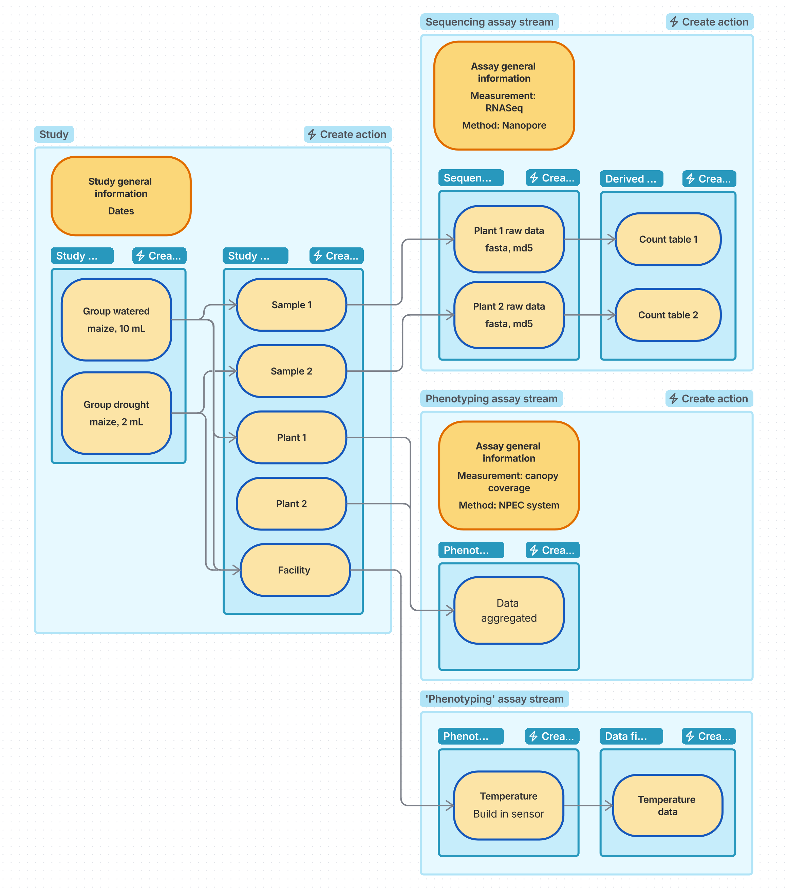

# High level example

## Experimental design

2 varieties (col-0, ler) and 2 watering regimes (well watered, drought) -> 4 experimental groups.

Measurements:

- RNA-seq of root and leaf samples
- Canopy coverage per experimental group
- Some general measurements from the greenhouse.

## Study general

Choose combined sequencing and phenotyping study. Optionally, add an [SOP](../../getting-started/glossary.md) with the experimental design map for MIAPPE — this can also be added later.

## Study source 

Create one source per experimental group. Specify the variety and watering regime. Add additional information that is relevant.

## Study samples

Create samples of type ‘sample’ for each root sample taken. The input is the source of the experimental group that the plant was grown in. Specify the plant structure/anatomical entity as root. 

Create samples for the leaf samples in the same way.

Create samples of type ‘observation_unit’ for each experimental group. The level is ‘plot’. The input is the source of that experimental group.

Create a sample of type ‘observation_unit’ that combines all sources. The level is ‘greenhouse’. 

 
## Assays

Create one phenotyping assay stream for canopy coverage and fill in all the information about the trait and the method. Create a first assay with material as output. Create a row for each measurement per experimental group, with the plot observation units as input. Create a next assay in the stream for the data files, one row for each file, with the matching row of the previous assay as input. Describe the output data file of the measurement and link to the data. 

Create one sequencing assay stream. Describe the library construction and sequencing. Create a first assay with material as output. Create a row for each library, with a sample as input. Create a next assay in the stream for the data files, one row for each file, with the matching row of the previous assay as input. Describe the output data file and link to the data. 

Create one phenotyping assay stream for the greenhouse sensors. Create an assay with the observation template, with material as output. Define one row per environment variable measured by the greenhouse sensors, describing the variable, the sensor and the scale. This can be one row for temperature and one for humidity. The input is the greenhouse observation unit of the study. Create a next assay in the stream for the data files, one row for each file, with the matching row of the previous assay as input. Describe the data and link to it. 

 
 